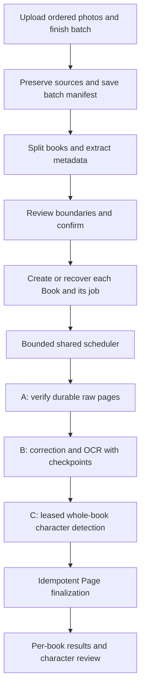

I recommend **reusing `background_pipeline`, with one durable job per detected book and a bounded scheduler**. Preserve the existing splitting, metadata matching, and confirmation flow. Replace its separate page-processing loop only after hardening the shared pipeline.

This is a substantial integration, not a safe “call the existing starter N times” change. The current background implementation has recovery and concurrency gaps that batch use would amplify.

I inspected `claude-dev` at `90d0198`. No files changed; tests were inspected, not run. GitHub was unreachable, so I could not independently confirm issue #84’s closed status.

**What the code establishes**

| Finding | Evidence |
|---|---|
| Black separators, cover fallback, per-group metadata, matching, creation and review exist. | [split_photo_batch](/home/expert/Documents/uob/fair_tales/FairTalesDataEntry/utilities.py:2351), [batch implementation](/home/expert/Documents/uob/fair_tales/FairTalesDataEntry/pages/add_books_batch.py:94) |
| **Batch never runs character detection.** `_create_books` registers books and processes pages, then returns summaries. | [_create_books](/home/expert/Documents/uob/fair_tales/FairTalesDataEntry/pages/add_books_batch.py:296) |
| The tuple-arity fix is present: `_process_page` is unpacked into three values. Batch then discards method and rotation uncertainty. | [batch page processing](/home/expert/Documents/uob/fair_tales/FairTalesDataEntry/pages/add_books_batch.py:238) |
| Reconstruction also discards those fields. `_register_processed_page` preserves them on successful extraction—it is the comparison implementation, not the same defect. Its OCR-failure branch still loses previously known correction information. | [reconstruction](/home/expert/Documents/uob/fair_tales/FairTalesDataEntry/book_reconstruction.py:388), [registration helper](/home/expert/Documents/uob/fair_tales/FairTalesDataEntry/pages/uploader.py:300) |
| Batch and collection fetch without upload-completion gating. Batch also deletes temporary uploads **before confirmation**, leaving review images only in session memory. | [batch upload](/home/expert/Documents/uob/fair_tales/FairTalesDataEntry/pages/add_books_batch.py:370), [collection upload](/home/expert/Documents/uob/fair_tales/FairTalesDataEntry/pages/collection_picker.py:430) |
| Background processing has phases A/B/C and transactional page claims, but Phase C remains check-then-act. | [claims and worker](/home/expert/Documents/uob/fair_tales/FairTalesDataEntry/background_pipeline.py:230) |

Several additional findings materially affect the decision:

- The worker sets `status='complete'` even when another worker still owns unfinished pages. `ensure_worker_running()` subsequently trusts that status and declines to resume. [Completion logic](/home/expert/Documents/uob/fair_tales/FairTalesDataEntry/background_pipeline.py:340)
- The public API assumes one session job. Its resume entry point requires the original byte list, although the private worker supports S3-only reads. Initial workers retain the whole byte list, contradicting the module’s constant-memory claim. [Job API](/home/expert/Documents/uob/fair_tales/FairTalesDataEntry/background_pipeline.py:435)
- The uploader supports **60 photos total, including separators**. Pipeline reuse alone does not deliver substantial multi-book capacity. [Upload limits](/home/expert/Documents/uob/fair_tales/FairTalesDataEntry/photo_upload.py:54)

The strongest alternative is to keep the current sequential loop and add one shared whole-book character call after each book. That is a defensible emergency patch: smaller regression surface, predictable serial execution, existing progress UI, and fewer new moving parts.

I reject it as the target architecture because durable recovery, retry control, per-book progress and duplicate prevention would then require rebuilding the job machinery beside `background_pipeline`. The existing field drift already demonstrates the maintenance cost of parallel implementations. If migration cannot pass representative pilot testing, the smaller patch is preferable to prematurely enabling the new backend—but it should remain explicitly transitional.

The recommended flow is:

A batch coordinator should own the ordered source manifest, group identities, metadata outcomes, confirmation state, and group-to-book/job bindings. Job identity must survive new browser sessions and must not depend on the extracted title or the current first/last-photo fingerprint. Persist validated AI settings and processing versions so resumption does not silently mix configurations.

Keep Streamlit rendering and entity persistence on the script thread. Workers receive explicit clients, configuration and source references; they must not switch `current_book` or resolve references through mutable session dictionaries. New persisted batch entities should use `DataStructureBase` and `Field`; operational claims remain encapsulated transactional methods in the pipeline storage layer.

Create N jobs, but initially allow **one active book job per application process**, with sequential pages. The limit must cover other upload flows too. Queue entries contain identifiers, not images. Fetch source images individually; bound thumbnail memory for metadata calls. Raise concurrency to two only after measurement. A process-local limit does not enforce an account-wide limit across multiple application instances; that would require shared admission control.

This conservative starting point follows Streamlit’s guidance to keep Streamlit APIs out of custom threads and recognises Community Cloud’s variable resource limits. [Threading guidance](https://docs.streamlit.io/develop/concepts/design/multithreading), [Cloud resources](https://docs.streamlit.io/deploy/streamlit-community-cloud/manage-your-app)

There is also an indirect thread dependency to remove: AI usage logging constructs `FirestoreWrapper`, which accesses Streamlit state/cache. Inject a recorder using the worker’s existing raw client, while retaining the normal script-thread default. [Usage recording](/home/expert/Documents/uob/fair_tales/FairTalesDataEntry/utilities.py:499)

**Characters should run automatically for every eligible book, but retain the existing review semantics.** Phase C currently makes one **text-only** call over that book’s ordered story-page OCR. It returns suggestions; it does not create `Character` or `Alias` records, and it does not detect illustration-only characters. [Detector contract](/home/expert/Documents/uob/fair_tales/FairTalesDataEntry/utilities.py:1678)

For each job:

- Wait until every expected page has a terminal result.
- Transactionally claim character detection for the current text revision.
- Run the paid call outside the transaction, then persist its result only if claim ownership and input revision still match.
- Distinguish successful suggestions, successful empty results, no usable text, failure, and incomplete OCR coverage.
- Expose a per-book review action that loads the durable result and reuses the existing reviewed Character/Alias commit logic.

Failed pages currently count as terminal, so detection can run over incomplete text. Preserve that useful behaviour, but visibly mark coverage as incomplete. Retrying pages changes the input revision and makes the earlier suggestions stale. Do not silently replace reviewed characters.

A successful empty result must not trigger another paid call on opening the book. The existing precomputed-suggestion helper currently conflates empty success with unavailable results. [Existing handoff behaviour](/home/expert/Documents/uob/fair_tales/FairTalesDataEntry/utilities.py:1829)

I would implement this in the following independently committable steps, adding relevant tests with each change:

1. **Repair page-result propagation without changing orchestration.**  
   Extract a shared result contract and explicit-book registration helper from `pages/uploader.py`, preferably into a non-page module. Carry correction outcome, `corrected`, `rotation_uncertain`, OCR outcome, text/story classification and page type separately. Use it in batch, reconstruction and single-book processing. Preserve correction flags even when OCR subsequently fails; retain import wrappers where needed.

2. **Fix upload readiness and premature cleanup.**  
   Update `photo_upload.py`, `pages/add_books_batch.py`, `pages/collection_picker.py` and `text_content`. Gate extraction on an explicitly completed upload generation, reject failed/missing slots, and freeze its ordered manifest. Stop deleting batch sources before confirmation/durable handoff.

   Simply adding `uploads_settled()` is insufficient: it retains a count-stability fallback. Current strict manifest matching also ignores failed uploads, and an old manifest can temporarily match while a new selection has started. A failed separator can merge two books, so these are correctness issues. [Readiness helpers](/home/expert/Documents/uob/fair_tales/FairTalesDataEntry/photo_upload.py:274)

3. **Harden shared claims and terminal states before adding batch traffic.**  
   In `background_pipeline.py`, fix #242 with a transactional character lease. Add lease renewal and owner-checked result commits for pages and characters; coordinate explicit API timeouts with leases. Mark extraction complete only when all required stages are terminal. Keep failed/partial outcomes distinct from success. Cancellation must prevent late workers publishing results.

   Leases reduce duplicate calls; they cannot guarantee exactly-once billing after a process dies between provider completion and Firestore persistence.

4. **Introduce an explicit job API and bounded scheduler.**  
   Add `create_or_get_job(...)`, `resume_job(job_id)`, `get_job_progress(...)` and per-job cancellation. Preserve the single-book session wrapper for compatibility. Resume from persisted page count and source keys, without original browser bytes. Checkpoint raw staging per page; a missing source must block that stage rather than become a misleading blank OCR result.

   Replace one-thread-per-job spawning with shared bounded admission. Add nonblocking progress snapshots; do not use the existing blocking 0.4-second polling loops for every dashboard row.

5. **Add durable batch coordination and idempotent book creation.**  
   Add batch models under `data_structures/` and a testable `batch_pipeline.py` service. Persist source order, split version, stable group identity, metadata results, owner and book/job references. Use a bounded manifest representation rather than an indefinitely growing Firestore document.

   Extend entity registration with atomic create/precondition support. Confirmation replay must recover the existing group binding, not generate another suffixed title. Handle competing batches with identical titles. Preserve unmatched metadata for review and retain existing author/illustrator/publisher matching behaviour.

   Store accepted sources in job-owned durable storage before clearing temporary uploads. Keep the batch discoverable by its owner across sessions.

6. **Make finalization and character handoff reusable and idempotent.**  
   Refactor `_finalize_job_batch` and the relevant `enter_text` helpers to accept explicit book/job identities. Materialize saved results without further AI calls. Atomically record materialization so replay cannot overwrite later human edits.

   Verify S3 reconciliation before declaring success; the current helper logs movement failures but still advances the prefix. Keep extraction completion, Page persistence and human review as separate states. Persist a job reference accessible from the book so character review survives losing the batch session.

7. **Route batch processing through the new service and add recoverable progress.**  
   Replace `_process_group_pages` after confirmation. Keep existing metadata matching and pre-creation review. Show boundary/source ranges and first/last thumbnails so users can catch incorrect grouping before books are created.

   Render one row per book: queued, staging, pages completed/failed, character outcome, finalization and review status. Poll compact snapshots periodically; fetch detailed results only when needed. Add “resume batch” discovery in the user-home flow. Ordinary reruns must never initiate fresh paid work.

8. **Deliver multi-chunk capacity and stage rollout.**  
   Extend the existing uploader to accept bounded chunks under one batch ID, with globally ordered slots, fresh presigned URLs and an explicit “Finish batch” action. A book may span chunks; chunk boundaries are not book boundaries. Bound cover-fallback and per-book metadata requests before increasing capacity.

   Enable new batches behind a rollout switch and record the backend choice durably. Never run both pipelines against the same book for comparison. Retain compatibility for existing jobs; retire the duplicate loop after pilot verification. Record the architecture and recovery guarantees in `DECISIONS.md`.

Across these commits: keep all user-facing strings in `text_content`; use narrow service/decode exceptions with visible outcomes; use `filter=FieldFilter(...)`; guard option lookups; preserve existing widget keys. New per-book controls need stable book/group keys, and value-seeded entity forms must use the captured `document_id`.

Browser closure should have these explicit semantics:

| Interruption | Required behaviour |
|---|---|
| During upload | Completed objects remain recoverable. Incomplete uploads block processing; failed/missing photos need retry. |
| After detection, before confirmation | Restore the preserved sources, boundaries and saved metadata. Do not repeat completed metadata calls automatically. |
| After confirmation, during extraction | Threads may continue while the application process lives. Completed checkpoints survive process loss. |
| After hibernation/redeploy | Reopening the owner’s batch reconstructs the queue and resumes unfinished work after valid leases expire. |
| After extraction, before entity finalization/review | Saved results await the script-thread consumer; reopening finalizes safely and presents character review. |
| After a paid response but before its result is saved | The outcome may be unknown; retry may incur another charge. Surface this uncertainty. |

Closing the last tab does **not inherently stop a daemon thread**, despite the current module comment. Conversely, Community Cloud cannot guarantee unattended completion through process shutdown. An external durable worker is a deliberate later option if “finishes while everyone is offline” becomes a requirement. [Cloud hibernation](https://docs.streamlit.io/deploy/streamlit-community-cloud/manage-your-app)

The repository describes seven-day expiry for `uploads/`, but I have not verified the live bucket policy. Recovery must not depend on temporary objects surviving indefinitely.

Cost is principally the existing work plus the missing character calls. For B books and P non-separator photos, excluding retries:

`calls ≈ optional cover-fallback call + 2–3 metadata calls/book + P OCR calls + crop/rotation checks + one character call/eligible book`

Black-frame detection has no AI cost. Character detection uses text, not every image again. Reuse makes it available architecturally, not financially free.

Durability adds S3 staging operations and Firestore writes/reads. Excessive polling, duplicated claims, repeating metadata and treating empty results as failures all inflate spend. Record usage by batch/job as well as the existing daily/model/flow totals; calculate actual cost through `ai_pricing.usage_cost`. Application-level bulk upload does not itself obtain Anthropic Message Batches pricing. Concurrency changes burst rate rather than normal call count; honour account-specific limits and `retry-after`. [Anthropic pricing](https://platform.claude.com/docs/en/about-claude/pricing), [rate limits](https://platform.claude.com/docs/en/api/rate-limits)

Testing should cover three distinct layers:

- **Unit/fake-service tests:** separators at every boundary, consecutive/all-black frames, corrupt photos, fallback output validation; immutable ordering and upload generations; correction flags surviving OCR failure; duplicate confirmation and title collisions; partial staging; settings snapshots; scheduler bounds; job completion transitions; per-book character input isolation; empty success; partial coverage; retry invalidation; idempotent finalization and protection of reviewed edits.
- **Integration tests with isolated services/emulators:** simultaneous page/character claims, lease expiry and stale-owner writes; competing book creation; crash between creation and binding; S3 copy failure; fresh-session resume with no byte list. Existing pipeline tests fake claims and therefore do not establish transactional correctness.
- **Human/deployment testing:** real Android/iPhone filename order and multiple selections; covered-lens photos versus dark covers; failed separator uploads; early clicks on slow connections; close/reopen at each phase; application restart; several simultaneous users; peak memory and throttling. Compare a known book through single and batch flows for page order, text, correction warnings, character/alias quality and references.

The known field-loss defects, missing upload gating and #242 should all be fixed before enabling the migrated batch flow. Leave the already-fixed tuple handling covered by regression tests. Defer automatic acceptance of character records, external workers and broad data-model redesign. Existing affected research records need a separate provenance-aware audit; a pipeline change cannot reliably reconstruct previously discarded orientation uncertainty.